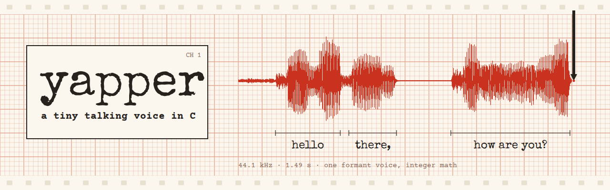
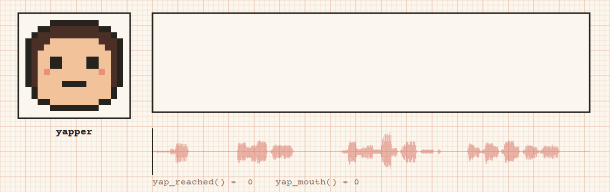
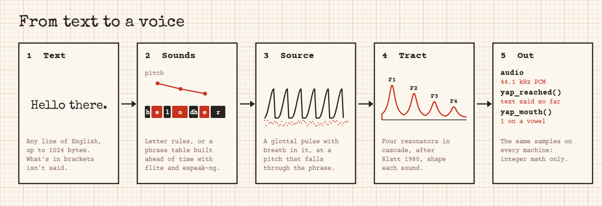

<p align="center"></p>

<p align="center">
  <a href="https://github.com/iamkaf/yapper/actions/workflows/ci.yml"><picture><source media="(prefers-color-scheme: dark)" srcset="https://shieldcn.dev/github/ci/iamkaf/yapper.svg?workflow=ci.yml&amp;branch=main&amp;variant=outline&amp;size=sm&amp;font=geist&amp;mode=dark"></picture></a>
  <a href="https://github.com/iamkaf/yapper/releases"><picture><source media="(prefers-color-scheme: dark)" srcset="https://shieldcn.dev/github/release/iamkaf/yapper.svg?variant=outline&amp;size=sm&amp;font=geist&amp;mode=dark"></picture></a>
  <a href="LICENSE"><picture><source media="(prefers-color-scheme: dark)" srcset="https://shieldcn.dev/badge/license-MIT.svg?variant=outline&amp;size=sm&amp;font=geist&amp;mode=dark"></picture></a>
</p>

Yapper is a tiny speech synthesizer in C. Give it text, and it gives back:

- **audio**, at 44.1 kHz;
- **how far it has got** through the text, so dialogue can type out in step with the voice;
- **whether the mouth is open**, so a portrait can move its lips on each vowel.

It is small and predictable:

- **About 9 KB** of code and tables. No C library, no allocation.
- **The same samples on every machine**, since it uses integer math only.
- **1,500 to 2,400 times faster than real time** on one core.
- **No data needed.** It reads words from their letters. For lines you know ahead of time, an optional phrase table says them better.

Yapper was built for Pinion, a game that has to fit on one floppy disk. It is a sibling of [Heddle](https://github.com/iamkaf/heddle) and [Pixzip](https://github.com/iamkaf/pixzip), which pack the same game's code and pictures.

## Listen

Turn the sound on. Each voice is a preset, and every line but the first is said from a phrase table:

https://github.com/user-attachments/assets/64012f40-f158-4f8a-b3f6-564c32ee5bfa

To hear the difference a phrase table makes, here is the man's voice saying "Hello there." [from its letters](docs/letters.wav) and [from a phrase table](docs/table.wav).

## Try it

Pre-built binaries for Linux (x86-64 and arm64), macOS and Windows are attached to each [release](https://github.com/iamkaf/yapper/releases).

To build it yourself, you need only a C compiler:

```sh
cc -O2 cli.c yapper.c compile.c pitch.c -o yapper -lm
./yapper say "Hello there. How are you today?" -o hello.wav
./yapper say "Is it raining outside?" --voice woman -o rain.wav
./yapper say "Come in, base. Over." --set radio=2 -o radio.wav
./yapper voices
```

On Windows, use MSVC from a Developer Command Prompt:

```bat
cl /O2 cli.c yapper.c compile.c pitch.c /Fe:yapper.exe
```

`yapper say TEXT -o out.wav` writes a 16-bit mono WAV. Its options:

- **`TEXT`** can be `-` to read from standard input.
- **`--voice NAME`** picks a preset. `yapper voices` lists them with their fields.
- **`--set KEY=VALUE`** changes one field of the voice. Repeat it for more.
- **`--phrases TABLE`** uses a phrase table.
- **`--cues`** prints a line each time the text reached or the mouth changes: the sample, the bytes of text reached, and 1 or 0 for the mouth.

```
$ ./yapper say "Hello there." --cues
0 0 0
7491 5 0
9661 5 1
13441 5 0
15611 5 1
19986 12 0
22366 12 1
28036 12 0
44101 12 0
```

The voice starts with a breath. It reaches "Hello" at sample 7,491 and opens its mouth for the "e" at 9,661. It reaches "there." at 19,986. The last line is where the audio ends.

## Use the library

<p align="center"></p>

Copy `yapper.h` and `yapper.c` into your project. They are freestanding C11 and need only `<stdint.h>`.

Each voice that talks needs a `yapper`: about 15 KB of state that you own. So several voices can talk at once.

```c
#include "yapper.h"

static yapper voice;

void start(void)
{
    yap_reset(&voice);
    yap_say(&voice, &yap_woman, "Is it raining outside?", 22);
}

/* Each audio callback: add the voice to the mix at half volume. */
void audio(int32_t *mix, uint32_t samples)
{
    yap_mix(&voice, mix, samples, 128);
}

/* Each frame: show the text as far as the voice has got, and open the mouth. */
void frame(void)
{
    draw_text(text, yap_reached(&voice));
    draw_mouth(yap_mouth(&voice));
}
```

### The API

| Call | What it does |
|---|---|
| `yap_reset(y)` | Silences a voice and resets all its state. Call it once before anything else. |
| `yap_say(y, voice, text, n)` | Starts saying the first `n` bytes of `text`, or up to a NUL, at most 1024. It replaces whatever was being said. |
| `yap_mix(y, mix, n, gain)` | Adds the next `n` samples into an `int32_t` buffer at `gain/256`, where 256 is full scale. |
| `yap_render(y, out, n)` | Writes the next `n` samples to an `int16_t` buffer instead, clipped. |
| `yap_reached(y)` | How many bytes of the text the voice has begun. Each word counts with the punctuation after it. Once done, the whole text's length. |
| `yap_mouth(y)` | 1 while a vowel sounds. |
| `yap_busy(y)` | 1 while there is sound to come. |
| `yap_hush(y)` | Fades the voice out over about 20 ms. The text then counts as reached. |
| `yap_phrases(y, table, size)` | Uses a phrase table from now on, or none if `table` is 0. The table isn't copied, so keep it alive. Returns -1 for a malformed table, which is then not used. |

Text in brackets, `( )` or `[ ]`, isn't said, so "(quietly)" can say how a line is spoken. Once the voice is done, `yap_mix` and `yap_render` give silence.

### Voices

A voice is a plain struct, `yap_voice`. The presets are `yap_man`, `yap_woman`, `yap_child`, `yap_elder`, `yap_giant` and `yap_robot`. Copy one and change its fields to make your own:

| Field | Meaning |
|---|---|
| `pitch` | Speaking pitch in Hz, 20 to 1000. |
| `range` | How wide the tune is, in 256ths of the pitch. |
| `pace` | Each sound's length in percent. Smaller is quicker. |
| `tract` | The formants' scale. 128 is a grown man's, about 150 a woman's. |
| `oq` | Open quotient: how much of each period the glottis is open, in 256ths. |
| `tilt` | The pulse's brightness, in 256ths. Lower is darker. |
| `breath` | Breath in the voice, in 256ths. |
| `flutter` | How much the pitch wanders, in 256ths. |
| `tremor` | An old voice's 5.5 Hz shake, in 256ths. |
| `volume` | Loudness, in 256ths. |
| `b1` | Extra width for the first formant, in Hz. |
| `soft` | A second pole on the pulse, in 256ths. It takes the buzz off the upper harmonics. |
| `style` | Bits: `YAP_WOMAN` women's vowel formants, `YAP_ASPIRATE` air through the glottis in time with it, `YAP_PARALLEL` formants side by side instead of in a cascade, `YAP_SMOOTH` a glottis that closes smoothly. |
| `pause` | Pauses between phrases in percent, with a breath drawn now and then. 0 gives short, even pauses. |
| `radio` | 0, or 1 to 3 to come over a radio channel, each stronger than the last. |

### Size and speed

| | GCC 16.2 | Clang 22.1 |
|---|---:|---:|
| Code | 7,301 | 8,616 |
| Read-only data | 1,678 | 1,592 |
| **Total bytes** | **8,979** | **10,208** |

Built for x86-64 with `-Os -ffreestanding -fno-asynchronous-unwind-tables`. On x86-64 it makes no calls outside itself.

On one core of a Ryzen 9 7900X, built with `-O2`, it speaks 1,500 to 2,400 times faster than real time, depending on the voice. `tests/bench.c` measures it:

```sh
cc -O2 tests/bench.c yapper.c -o bench && ./bench
```

Porting notes: it uses 64-bit integers, so a 32-bit target's compiler may call its own helpers for 64-bit division. It assumes right shifts of negative numbers are arithmetic, as they are on GCC, Clang and MSVC.

## Phrase tables

The letter rules get a lot of English wrong. A phrase table fixes that for the lines you know ahead of time. Put them in a text file, one line of speech per line, and compile it:

```sh
./yapper compile lines.txt -o lines.yph
./yapper say "Is it raining outside?" --phrases lines.yph -o rain.wav
```

`yapper compile` needs [flite](http://cmuflite.org) and [espeak-ng](https://github.com/espeak-ng/espeak-ng) on the `PATH`. It splits each line into phrases at punctuation, as the runtime does, and records for each phrase:

- each word's sounds, as flite's lexicon says them in context;
- each sound's length, as flite's slt voice says the line;
- which syllable espeak-ng stresses;
- each vowel's pitch, which `pitch.c` reads off flite's recording.

The runtime finds a phrase by a hash of its words, so a phrase is said from the table wherever it appears, in any line. A phrase the table doesn't hold is read from its letters. Nothing from flite or espeak-ng ends up in the runtime. [FORMAT.md](FORMAT.md) documents the table.

`compile.py` is the Python reference implementation that `yapper compile` was written from, and the tests check that both write the same bytes. Python is needed only for the tests and the reference.

## How it works

<p align="center"></p>

**The source.** The sound starts at the glottis, with one pulse each period. The pulse is [Rosenberg's](https://doi.org/10.1121/1.1912389), as in Klatt's KLGLOTT88, or a smooth rise and fall for a softer voice.

- Noise rides on it as breath, and a one-pole filter tilts its spectrum.
- The pitch wanders with two slow random walks, as a real voice does, plus jitter and shimmer from one period to the next.

**The tract.** The source goes through four two-pole resonators in a cascade, one for each formant, after [Klatt 1980](https://doi.org/10.1121/1.383940).

- Fricatives come from noise through a fifth resonator beside the tract, and "h" from noise through the tract itself.
- The coefficients are Q30 fixed point, and the controls update every 35 samples, or 0.8 ms.

**The sounds.** Each letter has formant targets for a grown man. The vowels come from [Peterson and Barney 1952](https://doi.org/10.1121/1.1906875); the consonants from the loci the formants move toward.

- The formants glide toward each sound's targets, and the `tract` field scales them for a smaller or larger speaker.
- `YAP_WOMAN` uses women's vowel formants from [Hillenbrand et al. 1995](https://doi.org/10.1121/1.411872) instead, since a woman's vowels aren't a man's scaled by one number.
- The letter rules handle silent final e's, doubled letters, "sh", "ch", "th", "ph", "ng", "ck", "qu", "x", and a soft or hard c.
- A word of more than three letters, or a capitalised one, gets its first syllable stressed.

**The tune.** Syllables run at about four a second.

- The pitch starts high and falls through each phrase, and each stressed syllable is lifted.
- The last syllable is longer. It falls for a statement, rises for a yes-or-no question, and lifts a little before a comma. A question that starts with "wh" or "how" falls.
- Commas, semicolons and full stops give pauses of their own lengths, and an ellipsis a longer one.
- A voice with a `pause` setting draws a short breath before a new sentence once it has spoken for a second and a half.

**The radio.** It band-limits the voice to 400 Hz to 3.4 kHz, drives it into a soft limit, and adds a carrier hiss and a burst of squelch as the channel opens and closes. Stronger settings narrow the band and add a small speaker's honk and crackle.

## Sources

- Dennis Klatt, ["Software for a cascade/parallel formant synthesizer"](https://doi.org/10.1121/1.383940), JASA 67, 1980: the resonators and the cascade.
- Dennis and Laura Klatt, ["Analysis, synthesis, and perception of voice quality variations among female and male talkers"](https://doi.org/10.1121/1.398894), JASA 87, 1990: the glottal pulse, breath and aspiration.
- Aaron Rosenberg, ["Effect of glottal pulse shape on the quality of natural vowels"](https://doi.org/10.1121/1.1912389), JASA 49, 1971: the pulse's shape.
- Gordon Peterson and Harold Barney, ["Control methods used in a study of the vowels"](https://doi.org/10.1121/1.1906875), JASA 24, 1952: the men's vowel formants.
- James Hillenbrand et al., ["Acoustic characteristics of American English vowels"](https://doi.org/10.1121/1.411872), JASA 97, 1995: the women's vowel formants.
- Alain de Cheveigné and Hideki Kawahara, ["YIN, a fundamental frequency estimator for speech and music"](https://doi.org/10.1121/1.1458024), JASA 111, 2002: `pitch.c`.
- [flite](http://cmuflite.org) and [espeak-ng](https://github.com/espeak-ng/espeak-ng), run by `yapper compile` when a table is built.

## Run the tests

```sh
CC=clang python3 test.py
```

This builds the command and the C checks with AddressSanitizer and UndefinedBehaviorSanitizer, in about 10 seconds. It checks:

- **The sound:** the SHA-256 of the samples for seven lines in every preset, from letters and from a phrase table, plus the radio's three strengths, against `tests/blessed.txt`.
- **Determinism:** GCC and Clang, each at `-O0` and `-O2`, give exactly those samples.
- **The cues:** the text reached only climbs and ends at the whole text, and the mouth opens and shuts.
- **Freestanding:** `yapper.c` compiles with `-ffreestanding -nostdlib` and needs no outside symbol.
- **The API's promises**, in `tests/api.c`: the same samples in any chunk size, two voices at once, mixing, hushing, cut-off text, every byte value, and random voices at the extremes.
- **Damaged tables:** every truncation, every byte damaged, thousands of random damages and malformed headers, each in a buffer of exactly its size. A malformed record must be read from its letters instead.
- **The compiler:** `yapper compile` writes the same bytes as `compile.py` on `tests/lines.txt` and on lines at the compiler's edges, when flite and espeak-ng are installed.

`python3 test.py --bless` rewrites `tests/blessed.txt`, for a change that is meant to change the sound. `COMPILERS` names the compilers to compare, `gcc clang` by default.

`tests/parity.py` checks Yapper against the code it was taken from, when that code is present:

- Set `YAPPER_ORIGIN` to the directory holding the original `voice.c`. Every preset and radio strength must give the original's samples exactly, from letters and from a phrase table, with the same text reached and mouth at every 1/60 s.
- Set `YAPPER_ORIGIN_PHRASES` to the original phrase compiler's output to also check that `compile.py` makes the same record for every phrase, and that `yapper compile` writes the same table as `compile.py`.

Without the original, it skips.

## Contributing and security

Bug reports and fixes are welcome. [CONTRIBUTING.md](CONTRIBUTING.md) says how to make a change and what CI runs. Report a suspected vulnerability privately, as [SECURITY.md](SECURITY.md) describes, not in a public issue.

## License

MIT. See [LICENSE](LICENSE).
